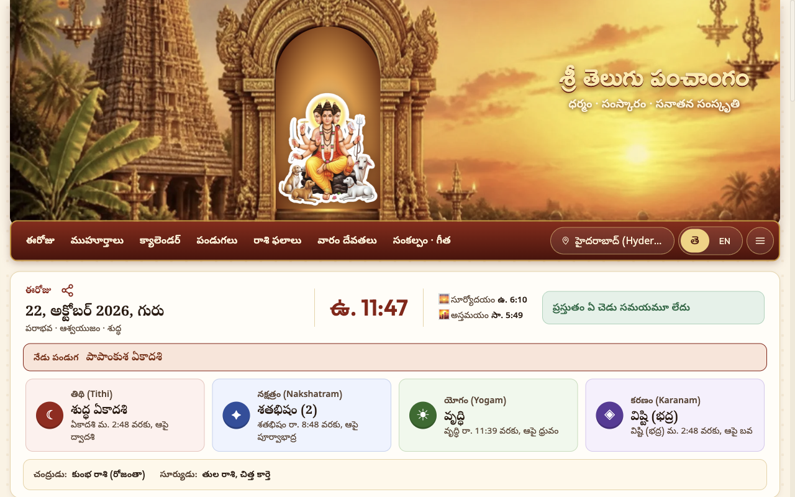
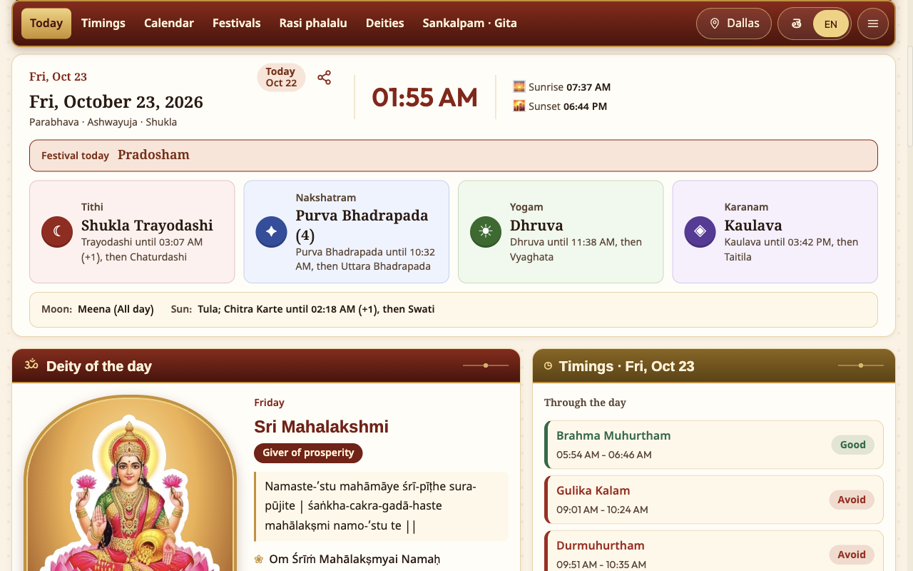
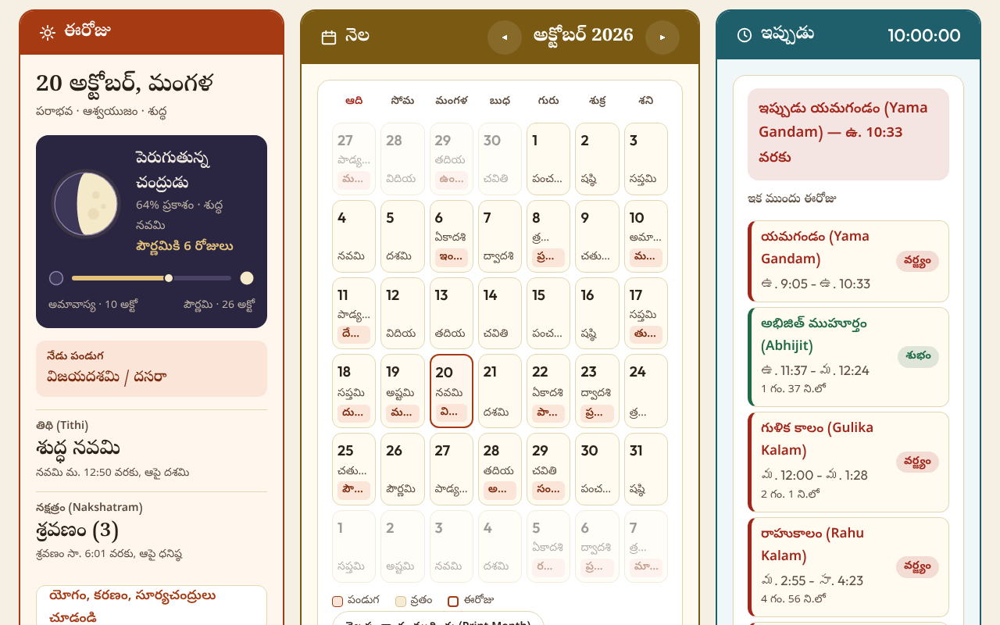
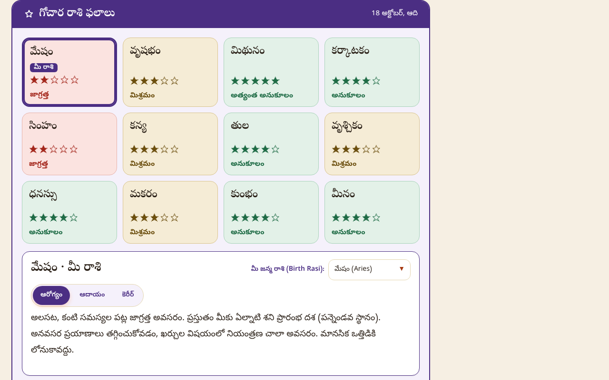
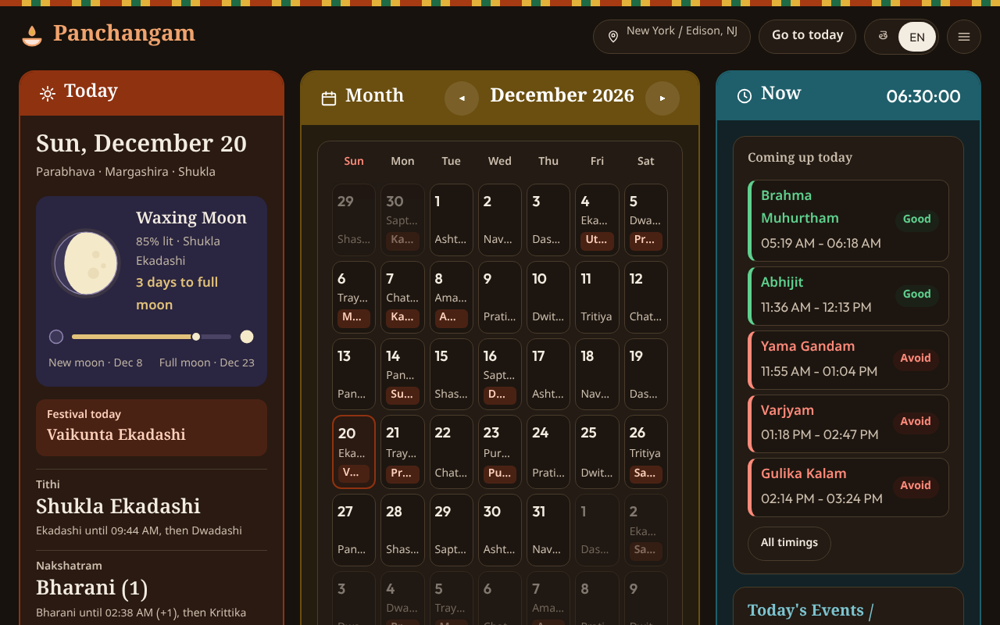

<div align="center">

# Telugu Panchangam (పంచాంగం)

**Today's Telugu Panchangam, computed for your own city.**
Tithi, nakshatra, Rahu Kalam, festivals and more, on your new tab or in any browser.

[**Open the web app**](https://ravitejakamalapuram.github.io/TeluguPanchangam/) · [**Add to Chrome**](https://chromewebstore.google.com/detail/obgpdlhkahmdiepklldjnnmfmbhmgenn)

</div>

<p align="center">
  
</p>

## Two ways to use it

| | Link | Good for |
| :-- | :-- | :-- |
| **Web app** | [ravitejakamalapuram.github.io/TeluguPanchangam](https://ravitejakamalapuram.github.io/TeluguPanchangam/) | Phone, tablet or any desktop browser. Nothing to install. |
| **Chrome extension** | [Chrome Web Store](https://chromewebstore.google.com/detail/obgpdlhkahmdiepklldjnnmfmbhmgenn) | Replaces your new tab with today's Panchangam. Works offline. |

Both run the same Panchangam engine, so the numbers match.

## What you get

- **Daily Panchangam:** tithi, vara, nakshatra, yoga and karana, with end times running to the next sunrise as in a printed Telugu panchangam.
- **Daily timings:** Rahu Kalam, Yamagandam, Gulika Kalam, Durmuhurtham and Varjyam.
- **Festivals and vratas:** the next festival at a glance, plus every Ekadashi with the time to break the fast.
- **Your city:** pick from the built-in list of places in India and the United States. Time zones and daylight saving are handled for you.
- **Rasi Phalalu (రాశి ఫలాలు):** all 12 rasis at a glance, following the Moon's transit. A daily reading, not a prediction.
- **Sankalpam (సంకల్పం):** generated automatically with the right Samvatsara, Ayana, Ritu and Masa for your pooja.
- **Bhagavad Gita verse of the day:** Sanskrit, transliteration and English.
- **Telugu or English**, with a light, dark or automatic theme.
- **Share cards** for the day, festivals, rasi and more.

<p align="center">
  
  
</p>
<p align="center">
  
  
</p>

## Privacy

- **The Chrome extension makes no network requests of its own.** No analytics, no ads, no servers. Your city, name, birth details and reminders stay on your device.
- **The web app** uses only a cookieless page-view counter ([GoatCounter](https://www.goatcounter.com/)). It sets no cookies, stores nothing in your browser, sends no personal details, and is skipped when your browser sends Do Not Track or Global Privacy Control.
- The optional "Use My Location" button hands off to Chrome's built-in location service, and only if you press it.

Full details are in [PRIVACY.md](PRIVACY.md).

## Feedback and bugs

Found a wrong date or a rough edge? [Open an issue](https://github.com/ravitejakamalapuram/TeluguPanchangam/issues). The app's "Report a problem" button opens a prefilled issue that you can read and edit before sending.

## For developers

Requires Node.js.

```sh
npm install
npm test            # unit tests and smoke test
npm run build:web   # builds the web app into dist/
```

To try the extension locally, open `chrome://extensions`, turn on Developer mode, choose **Load unpacked** and select this folder.

The Panchangam engine lives in [`core/`](core/README.md). Release history is in [CHANGELOG.md](CHANGELOG.md), and fonts and data sources are credited in [CREDITS.md](CREDITS.md).
